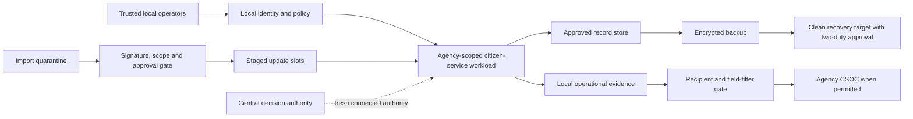

# 08 — Government landing-zone architecture

Ashish Srivastava · 19 November 2026 · **Architecture design**

## Architecture proposal

This design separates management, workload, evidence and transfer authority. It is a proposed government landing zone, not deployed infrastructure or a provider accreditation claim.

| Plane | Owner | Permitted reach | Required separation |
| --- | --- | --- | --- |
| Management | Security / operations | Approved provisioning, trust inputs and emergency approvals | No general citizen-record access by management role |
| Workload | Service owner | Assigned agency/object/action | No cross-agency access; no implicit export authority |
| Evidence | CSOC / records owner | Approved operational signals | Classification, freshness, recipient and purpose gates |
| Transfer/recovery | Procurement / recovery owners | Quarantine, signed promotion and clean restore | Separate approvals and independently protected keys/state |

## Deployment gates

Choose an actual platform before adding infrastructure-as-code. Then enforce identity/network/storage boundaries, verify support and placement dependencies, and exercise restart/restore against approved agency objectives. The lab's one container and policy functions do not establish these infrastructure boundaries.

## Inspect the artifacts

[Boundary decisions](sovereign-boundaries.md) · [Acceptance pack](../applications/supplier-and-update-admission.md)

## Primary references

- [NIST SP 800-207 — Zero Trust Architecture](https://nvlpubs.nist.gov/nistpubs/SpecialPublications/NIST.SP.800-207.pdf) — 2020-08
- [NIST SP 800-53 Rev. 5 official OSCAL catalog](https://raw.githubusercontent.com/usnistgov/oscal-content/main/nist.gov/SP800-53/rev5/json/NIST_SP-800-53_rev5_catalog.json) — 5.2.0

[All 24 contributions](../docs/contributions-01-24.md) · [Recorded verification and practical limits](../docs/verification.md)
