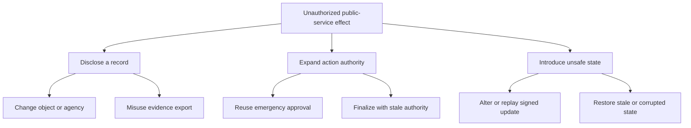

# 06 — Citizen-service threat model

Ashish Srivastava · 19 November 2026 · **Evidence-linked threat model**

## Scope and trust boundaries

Assets are synthetic citizen records, local identities, review authority, release trust inputs, operational evidence and recovery material. Boundaries separate operator sessions from server-held scope, agencies from each other, local decisions from central finalization, imports from active state and local evidence from external recipients.

| Threat | Misuse path | Fixture evidence | Remaining limitation |
| --- | --- | --- | --- |
| T1: record disclosure | Change a record ID in a valid request | Cross-object and cross-agency API denials | No production identity or database policy enforcement |
| T2: action escalation | Use a viewer or service token to acknowledge/finalize | Viewer/service action denied; finalization stops offline | Finalization is a synthetic response, not a real government decision |
| T3: emergency authority abuse | Reuse or retarget an approval | Context, distinct duties, expiry and single-use checks | Handles and identities are in memory |
| T4: supplier/update compromise | Alter a package or target another site | Pinned signing inputs, digest/site/provenance/approval checks | Durable anti-rollback and supplier assurance remain unresolved |
| T5: false central assurance | Treat old or missing reports as current | Current/delayed/missing/unverified states | No distributed clock or signature verification in this freshness model |
| T6: disclosure misuse | Export record fields or change recipient/purpose | Field filtering and negative export cases | Local custody digest is not recipient receipt or full audit custody |
| T7: recovery loss | Restore an incomplete/wrong-key backup | Wrong key/dirty target denied; actual post-snapshot loss enumerated | Tiny fixture, ephemeral wrapping keys, no whole-service RTO |
| T8: AI authority escalation | Retrieve another agency's record or execute shell | Retrieval/tool allowlist denials | Deterministic router, no real-model prompt evaluation |

Run the legitimate-use cases before interpreting a denial as successful protection. A failing request is useful only when the permitted baseline remains functional.

## Inspect the artifacts

[Boundary regression cases](../../tests/test_government.py) · [Observed scenarios](../../tools/exercise.py)

## Primary references

- [NIST SP 800-207 — Zero Trust Architecture](https://nvlpubs.nist.gov/nistpubs/SpecialPublications/NIST.SP.800-207.pdf) — 2020-08
- [NIST SP 800-53 Rev. 5 official OSCAL catalog](https://raw.githubusercontent.com/usnistgov/oscal-content/main/nist.gov/SP800-53/rev5/json/NIST_SP-800-53_rev5_catalog.json) — 5.2.0

[All 24 contributions](../../docs/contributions-01-24.md) · [Recorded verification and practical limits](../../docs/verification.md)
